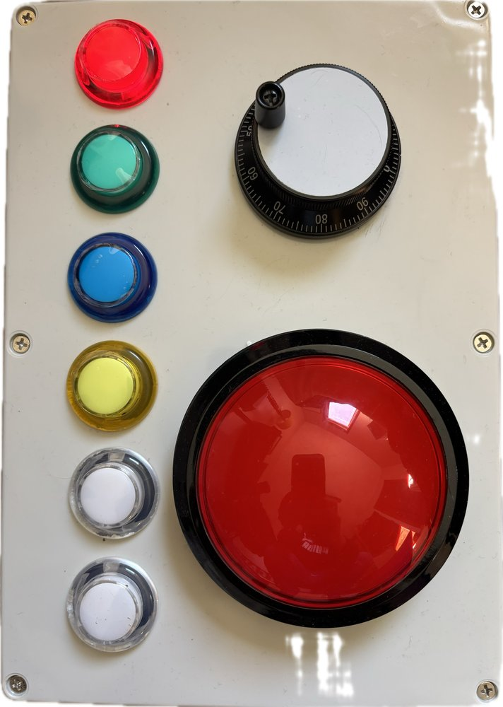

# VoiceOver Switch Box



A large-button controller that lets someone who is blind or low-vision, non-speaking, and has limited motor control use an iPad. It plugs in over USB-C (or pairs over Bluetooth) as an ordinary keyboard and drives:

- **VoiceOver**, the iPad's built-in screen reader: a big wheel moves between items, a big button activates them, and a column of buttons covers reading, Home, muting speech, media and closing apps.
- **TD Snap** switch scanning (2-switch step scan) for AAC communication.

It was built for one student, so every choice favours being impossible to get stuck over flexibility. It's a Raspberry Pi Pico 2 W, off-the-shelf arcade buttons, a 60 mm CNC jog wheel and under 700 lines of firmware. No custom PCB is needed.

> **Status:** built and working with an iPad; still being tuned. The firmware is checked by a 44-scenario simulator and the box has been tested with iPadOS VoiceOver, but some commands are only as good as the apps they run in. See [What works and what doesn't](#what-works-and-what-doesnt).

## Controls

**Layout:** the wheel is top right and the big select button bottom right. The left column, top to bottom, is Red, Green, Blue, Yellow, then the two clear buttons: Chooser, then Back at the bottom.

| Control | VoiceOver mode | TD Snap mode |
|---|---|---|
| Wheel forward / back | Next / previous item | Advance the scan (Space) |
| Big button (100 mm) | Activate (double-tap) | Select (Enter) |
| Red | Read everything from here | Advance (Space) |
| Green | Home screen | Select (Enter) |
| Blue | Mute / unmute VoiceOver's voice (VoiceOver stays on) | Back (Esc) |
| Yellow | Magic Tap: play/pause, answer/end call | Home (Cmd+H) |
| Chooser | Close the current app (pause media, close, Home) | Next field (Tab) |
| Back | Back / dismiss (Esc) | Back (Esc) |
| Back + Chooser, hold 3 s | Switch to TD Snap mode | Switch to VoiceOver mode |
| Back + Green, hold 3 s | Turn VoiceOver Quick Nav on/off (Green goes Home first) | Nothing extra (Green still selects) |

The Red button glows whenever the box has power. The mode is remembered when the box is unplugged. The Pico's LED, inside the box, shows the mode: on 1 s / off 1 s is VoiceOver mode, twice as fast is TD Snap mode. If a piezo is fitted, the box beeps once or twice on start-up and when switching. Back and Chooser act when released, so starting a two-button hold never sends anything.

## Quick start

1. **Build the box.** See the [parts list](hardware/BOM.md) and the illustrated [build guide](docs/build-guide.html). Download the build guide and open it in a browser (GitHub shows `.html` files as code); it has wiring diagrams, drill templates and the firmware built in.
2. **Flash the firmware.** Hold BOOTSEL on the Pico while plugging it in, then copy [`firmware/prebuilt/voiceover_device_ble.uf2`](firmware/prebuilt/) onto the `RP2350` drive that appears. Once a box has firmware, later updates don't need BOOTSEL. Use the Arduino IDE's Upload button (it resets the board itself), or on a Mac run:
   ```sh
   stty -f /dev/cu.usbmodem* 1200; sleep 4; cp -X firmware/prebuilt/voiceover_device_ble.uf2 /Volumes/RP2350/
   ```
3. **Set up the iPad.** Follow the [iPad setup checklist](docs/ipad-setup.md). It is short, but a few settings, such as Picture in Picture and the Dictation shortcut, matter a lot.

## Building the firmware yourself

- **Arduino IDE 2:**
  - Add the [arduino-pico](https://github.com/earlephilhower/arduino-pico) board package (core 6.3.0 tested).
  - Pick **Raspberry Pi Pico 2 W**.
  - Set **Tools → IP/Bluetooth Stack → IPv4 + Bluetooth** and leave **USB Stack** on **Pico SDK**.
  - Open `firmware/voiceover_device_ble/voiceover_device_ble.ino`.
- **arduino-cli:**
  ```sh
  arduino-cli compile -b "rp2040:rp2040:rpipico2w:ipbtstack=ipv4btcble" firmware/voiceover_device_ble
  ```

Everything you are likely to tune is in the `SETTINGS` block at the top of the sketch:
- Wheel counts per step and direction
- Debounce, a minimum hold time, and an ignore-repeat window, for users with tremor
- The two-button hold time
- The Bluetooth name

Each button's action is in the `INPUT_ACTION` table just below it.

### Simulator

`sim/` compiles the real sketch on a desktop against mock Arduino, TinyUSB, Bluetooth and EEPROM layers, with virtual time. Run it with:

```sh
./sim/run.sh firmware/voiceover_device_ble/voiceover_device_ble.ino
```

It covers:
- The wheel: jitter, fast spins, reversals, and stopping when the hand stops.
- Debounce and the hold / ignore-repeat options.
- Every button in both modes, and the two-button holds.
- Mode memory across reboots.
- Keystroke timing: modifiers first, a 60 ms hold, Control never pressed alone, and a slow-polling iPad.
- USB/Bluetooth routing, including a USB host that stops reading and one that is asleep.
- The watchdog and the serial test port.

CI runs the simulator and a full firmware build on every push.

### Serial test port

Plug the box into a computer and open its serial port (Arduino IDE → Tools → Serial Monitor). Type `?` to get the firmware version, the mode, whether a USB host is reading keys, and whether Bluetooth is connected.

Single letters press buttons through the same path as the real switches:

| Key | Does |
|---|---|
| `n` / `p` | Wheel forward / back |
| `s` | Big button |
| `r` `g` `b` `y` `c` | Red, Green, Blue, Yellow, Chooser |
| `e` | Back |
| `m` | Switch mode |
| `q` | Toggle Quick Nav |

An iPad never opens this port, so it has no effect in normal use.

## What works and what doesn't

Things that took real debugging, in case you are building something similar:

- **iPad VoiceOver ignores fast key combinations.** A Mac accepted Control+Option+arrow pressed and released within a few milliseconds. iPadOS VoiceOver ignored it: the iPad saw the key held for 1–3 ms. The firmware now types every combination like a person would:
  - Modifiers go down 40 ms before the key, and come up after it.
  - The key is held for 60 ms.
  - Each delay is timed from when the iPad actually reads the USB report, not from when the box queued it.
- **Two bare Control taps open Dictation on iPadOS.** VoiceOver swallows the arrow from Control+Option+arrow, so the system sees a lone Control tap. Option now goes down before Control, and the modifiers stay held through a fast wheel spin.
- **USB can freeze a naive HID firmware.** If the host enumerates the box but isn't reading the keyboard, the stock library blocks for up to 500 ms per report. The firmware checks the endpoint first and falls back to Bluetooth.
- **Some apps are hard to use with VoiceOver at all.** Streaming apps with auto-hiding controls and sideways-scrolling rows trip up VoiceOver itself, so a wheel can't fix them. Green (Home) always gets the student out.
- **The USB-C panel coupler only passes power one way round.** The iPad's cable has to go into the box one way up; the Red button lights when it's right. Leave the cable plugged into the box and unplug it only at the iPad, whose port works either way. A USB-C-socket-to-micro-USB panel cable with pull-downs on both CC pins would work both ways up.
- **Untested:** the hardware PCB in `hardware/pcb/` (never fabricated), and Chooser's close-app sequence across all apps.

## Repository layout

```
firmware/voiceover_device_ble/   main sketch
firmware/prebuilt/               ready-to-flash .uf2
firmware/tools/keytest/          types each control's name; for checking wiring
firmware/tools/usbdiag/          blinks a code showing how far USB setup got with a host
sim/                             desktop simulator and test scenarios
hardware/BOM.md                  parts list
hardware/wiring.md               pin map and wiring
hardware/pcb/                    optional carrier PCB (SKiDL netlist, untested)
docs/ipad-setup.md               iPad settings checklist
docs/build-guide.html            full illustrated build guide (open in a browser)
docs/images/                     photos
tools/box-key-check.html         web page that shows exactly what keys a device receives
```

## License

[MIT](LICENSE). Use it, change it, build them for your students.
